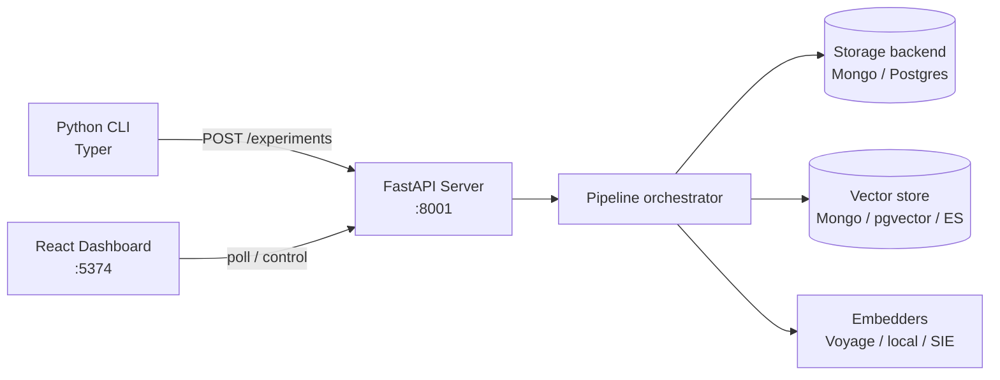

# Architecture Growth Log

Rolling, **append-only** record of how the architecture evolves, one entry per slice close.
The seed **Baseline** below is the collective L1 of all completed slices; past slices are **not**
retrofitted. Each new Must/Should slice appends a `### <date> — Slice NN: <name>` **Delta** at close
(see [`slices/README.md`](slices/README.md) § Abstraction Views).

Canonical, always-current architecture: [`../contributor-guide/architecture.md`](../contributor-guide/architecture.md)
and [`../contributor-guide/module-theme-map.md`](../contributor-guide/module-theme-map.md). This log is the
*history of change*, not a second SSOT.

---

### 2026-09-26 — Baseline (seed)

**L1 — Context** (system in one diagram)

Text fallback: **CLI** submits YAML configs to the **FastAPI server**; the **dashboard** observes and
controls sweeps. The server runs a **pipeline** that talks to a **storage backend** (run state) and a
**vector store** (chunks) through Protocol ports, and to pluggable **embedders**.

**L2 — Process** (pipeline phases + ports)

- Phases: `QUEUED → PARSING → CHUNKING → EMBEDDING → STORING → QUERYING → RERANKING → COMPLETE`.
- Ports (SSOT): `StorageBackend` (experiment/run/chunk/result CRUD + cascade) and `RetrieverBackend`
  (dense/sparse/hybrid) resolved via `server/db/ports/store_factory.py`.
- Split-store: `get_storage_backend()` (run state) vs `get_vector_store()` (chunks); `get_retriever_backend()`
  resolves via the vector store. `VECTOR_STORE_BACKEND` defaults to `STORAGE_BACKEND`.
- Provider dispatch: `server/core/embedding/embedder_factory.py` (Voyage / local / SIE; DoubleWord proposed).

**Data-Flow**: `CLI → POST /experiments → BackgroundTask per experiment → per-config run
(parse → chunk → embed → vector write → query → rerank → store results) → stores → dashboard polling`.

**Established invariants at seed**: dual-backend additive (Mongo default permanent, #130); mandatory
`embedding_model` + `experiment_id` + `run_id` filter on vector queries; single-worker `SWEEP_EXECUTOR`.
Full list: [`invariants.md`](invariants.md).

---

<!-- Append new slice deltas below this line, newest last. Template:

### <YYYY-MM-DD> — Slice NN: <name>
- **Delta**: what structurally changed (new module / port / phase / data path).
- **L1/L2 impact**: which box or edge above moved; link the slice's Abstraction Views.
- **Data-Flow**: only if the data path changed.
-->

### 2026-09-27 — Slice 50: Elasticsearch adapter core
- **Delta**: `server/db/elasticsearch/` is a vector-only registry adapter (`can_host_run_state=False`). One `{prefix}-chunks` index holds `embedding_384` and `embedding_1024` as explicit unquantized HNSW. Dense, sparse, and hybrid search share `rrf_fuse` with Mongo; Postgres still fuses in SQL.
- **L1/L2 impact**: the vector-store box now includes Elasticsearch beside Mongo and pgvector. Run state stays on Mongo or Postgres.
- **Data-Flow**: chunk write/search/delete for `VECTOR_STORE_BACKEND=elasticsearch` goes to Elasticsearch (`refresh=wait_for` on bulk, delete-by-query on delete). Experiment, run, and result rows stay on the run-state store.

### 2026-09-27 — Slice 51: Elasticsearch operability
- **Delta**: `scripts/lib/stores.tsv` is the operator manifest for start, stop, and health probes. `GET /api/stores` is the public catalog (labels, example config, index summary; secrets omitted). The server image takes optional `EXTRAS=elasticsearch`. Nightly live tests are one `vector-store-integration` matrix.
- **L1/L2 impact**: a fresh clone can start local Elasticsearch beside the existing Mongo and Postgres paths. The vector-store box is unchanged from Slice 50; the new edge is operator scripts and the catalog API.
- **Data-Flow**: unchanged from Slice 50. `--elasticsearch-local` pairs Elasticsearch vectors with Postgres run state unless `STORAGE_BACKEND` is already `mongodb`.

### 2026-09-28 — Slice 51: close
- **Delta**: Postgres sparse and hybrid OR the `websearch_to_tsquery` lexemes, matching Atlas Search and Elasticsearch `match` any-term behaviour. Atlas Local's healthcheck requires a writable primary, and the compose hostname is the replica-set name for the life of the volume. `--elasticsearch-local` pairs MongoDB run state unless `STORAGE_BACKEND=postgres`.
- **L1/L2 impact**: no new box. The Postgres retrieval edge now ranks partial question matches.
- **Data-Flow**: unchanged.

### 2026-09-30 — Slice 52: Redis evaluation spike
- **Delta**: Docs-only research (no product code). `docs/_internal/REDIS-EVALUATION.md` (6-stream research report: delta map, candidate free-gate verdicts, adoption metrics, PoC transcript, Branch B verdicts, weighted scoring). `docs/_internal/redis-evaluation.html` (self-contained interactive guide with live weight slider). `docs/adr/ADR-007-redis.md` (Proposed: Redis 8 or Valkey as vector-only store, mirrors ADR-006 shape). DECISIONS #272–#273 (GO/NO-GO stubs for Slices 53/54, PENDING owner decision).
- **L1/L2 impact**: no code box changed. ADR-007 Proposed marks the intent to add Redis as a fourth vector-store option beside Mongo, Postgres, and Elasticsearch. The zero-changes criterion is verified: adding Redis requires only one `DatabaseProvider` token and Docker infra — no routes, sweep logic, UI, or CLI changes.
- **Data-Flow**: no change. Slice 53 (Branch A GO) will add `VECTOR_STORE_BACKEND=redis` data path alongside the existing three. Branch B (embedding cache) remains Could pending Slice 54.

### 2026-09-30 — Slice 53: Redis vector-store adapter
- **Delta**: `server/db/redis/` (8-module package) added as the 4th vector-only `VectorStoreAdapter` behind the Slice 49 registry. Score convention `score = 1 − d/2` (COSINE distance → [0,1]). `redis-py` is a lazy-import optional extra (`.[redis]`). Preflight checks Query Engine presence (FT._LIST), eviction policy (`allkeys-*` → 422, `volatile-lru` → warning), AOF state (off → warning), and capacity. Vector keys carry TTL = -1 (never expire); `volatile-lru` therefore never evicts them without explicit misconfiguration. `redis-local` Docker Compose profile (Redis 8, AOF on, `--maxmemory 256mb volatile-lru`, bind `0.0.0.0 --protected-mode no`). `--redis-local` start-services flag pairs Redis vectors with `sqlite` run state by default (ADR-008; was `mongodb-local` pre-remediation). 9 example YAML configs. 152 unit tests via `sys.modules` injection (no live Redis required), 99.61% branch coverage. *Post-PASSED (`fix/redis-readiness-audit-remediation`): import path fix, `_is_not_found` precedence bug, 500-doc batching, `UNLINK`, `EF_RUNTIME`, sparse OR-tokenized query, pipelined HGET stats, `run_config_preflight()` via guard. **E2E verified** (2026-10-09): 4 runs (dense/sparse/hybrid/cross_encoder) on Redis Stack Server 7.4.7; deletion cascade verified; audit verdict NO-GO → GO.*
- **L1/L2 impact**: the vector-store box now includes Redis beside Mongo, pgvector, and Elasticsearch. `DatabaseProvider` Literal widened to include `"redis"`. `can_host_run_state=False` enforced (D1 boundary: `STORAGE_BACKEND=redis` → 422). `nightly.yml` gains a fourth `vector-store-integration` matrix leg (redis:8). Operator script (`stores.tsv`) gains a redis row.
- **Data-Flow**: chunk write/search/delete for `VECTOR_STORE_BACKEND=redis` goes to Redis (`HSET` per chunk, `FT.SEARCH` for retrieval with client-side RRF hybrid, `UNLINK` for async non-blocking delete). Experiment, run, and result rows stay on the run-state store (MongoDB, Postgres, or SQLite).

### 2026-11-05 — Slice 56: Meetup demo kit (parts A, C1, B, C3 on branch)
- **Delta**: a read-only export path now feeds an offline demo. `scripts/walkthru/export_walkthru_results.py` opens run-state SQLite files with `mode=ro`, ranks the union once with `analyze_results`, and writes one deterministic JSON (`docs/about/walkthru-results.json`, with an input manifest). `frontend/src/walkthru/walkthruResults.ts` is the shared data contract; the demo components in `frontend/src/components/walkthru/` (`RunReplay` over a pure `replayAdapter`, `CrossStoreLeaderboard` over `leaderboard.ts`) and the About box (`Dialog`, in-repo Markdown renderer) read the bundled JSON with no network calls. `docs/about` is mirrored into `frontend/src/walkthru/about` by a `prebuild` script because `docs/` is outside the Docker build context.
- **L1/L2 impact**: no change to the server, the ports or the vector-store box. New leaf on the frontend side only: exporter -> bundled JSON -> demo components. `BestParamsCard` and `CollapsibleCard` gained optional props with unchanged defaults.
- **Data-Flow**: run state (SQLite) -> exporter -> `walkthru-results.json` -> frontend bundle -> replay and leaderboard. The exporter never imports or contacts a vector store; at demo time nothing reaches the server.

### 2026-11-05 — Slice 67A: shared sweep formula on the Detail header
- **Delta**: dashboard counts for the sweep header move from inline JSX arithmetic to one pure function (`sweepFormulaFromSummary`) rendered by one component (`FormulaLine`). The Explorer reuses the component and passes its observed count, which renders as `(observed)` when it differs from the product.
- **L1/L2 impact**: frontend only. No server, port or store change. `expand_sweep` remains the backend truth; the frontend mirror (`paddings []` -> 1, default dense retriever) is replaced by the backend `sweep_plan()` in 67B.
- **Data-Flow**: `sweep_summary` (API) -> `sweepFormulaFromSummary` -> `FormulaLine`. A static guard test pins the determinism rule for these modules and the two screens.

### 2026-11-05 — Slice 67B: backend `sweep_plan()`
- **Delta**: one pure function (`sweep_plan`) beside `expand_sweep` now owns the sweep counts the dashboard will explain; `GET /experiments/{id}` attaches it on read from `doc["config"]`.
- **L1/L2 impact**: server only, additive. No store, port or migration change; `grid_equivalent_count` and the Bayesian stop condition are unchanged, the helpers merely moved into `config.py` (orchestrator and lifecycle import from there).
- **Data-Flow**: stored config -> `attach_sweep_plan` (fail-isolated) -> response `sweep_plan` -> (67D) `FormulaLine` and tips. The remaining parallel derivations of planned runs are listed as follow-ups in the slice spec.

### 2026-11-05 — Slice 67C: one tooltip primitive
- **Delta**: explanations of numbers get one primitive (`InfoTip`) with its pure helpers (`clampShift`, label templates) instead of per-card native `title=` attributes or always-visible hint text.
- **L1/L2 impact**: frontend leaf components only. No data or server change; consumers (`StatTile`, `StatCard`, `CollapsibleCard`) take optional props with unchanged defaults, except that `StatTile.hint` now shows on demand.
- **Data-Flow**: none new. Explanation strings are produced by pure functions in the calling screens (67D) and passed in as text.

### 2026-11-05 — Slice 67D (first bundle): one denominator, pure label helpers
- **Delta**: the Detail, list, Compare and stats screens take their counts and explanation sentences from named pure helpers (`detailDenominator`, `bayesianNotStartedCount`, `bayesianTotalsLine`, `progressSentence`, `scoreLabels`, `estimateLabels`) instead of per-screen arithmetic; the determinism guard grew a positive control and a per-module clock allowance.
- **L1/L2 impact**: frontend plus one Python contract test; no server behaviour change. `sweep_plan` (67B) and `InfoTip` (67C) are not wired in here yet.
- **Data-Flow**: API response (`bayesian_summary`, `run_count`, runs) -> pure helpers -> screens. The estimate formula constants are checked against `stats_common.py` by a test so the on-screen explanation cannot drift from the server.

### 2026-11-05 — Slice 67E (backend): golden-record facts in the stats assembly
- **Delta**: the backend-agnostic stats assembly (`stats_common.py`) now derives result-run, golden-query and partial-run facts from per-run result counts that each adapter already builds; the orchestrator persists the golden dataset's record count once on the experiment.
- **L1/L2 impact**: additive fields on the db-stats responses and one best-effort write to `sweep_summary` after the queries load. No new store method or index. Redis and Elasticsearch report nothing new; the run-state overlay carries the facts for every backend on the detail view.
- **Data-Flow**: `load_queries` -> `sweep_summary.golden_queries` (write once) -> adapters' per-run counts -> `assemble_experiment_db_stats` -> db-stats response -> (frontend half) the Query Results breakdown.

### 2026-11-05 — Slice 67E (frontend): the Query Results breakdown as pure helpers
- **Delta**: `resultsBreakdown.ts` turns the golden-record facts into a formula, an "(observed)" line, a group summary and a partial-runs note; `ResultsBreakdownView.tsx` renders them with the shared `FormulaLine`; `storageUsage.ts` takes the last arithmetic out of `VectorDbStatsPanel`.
- **L1/L2 impact**: frontend only, plus one Python contract test (`test_results_breakdown_types_contract.py`) that compares `types/index.ts` with the keys the real stats assembly emits. `pluralize` and `FormulaLine` gain an optional number formatter; `StatTile.hint` accepts a node.
- **Data-Flow**: db-stats response (`result_runs`, `golden_queries`, `golden_queries_source`, `partial_runs`, `total_results`) or group totals -> pure builders -> footprint line / tile hint; absent facts render nothing.

### 2026-11-06 — Slice 67F: pure duplicate-count function in compare
- **Delta**: a pure `count_duplicates_collapsed(slot_keys)` in `server/core/compare.py` replaces the implicit understanding that the leaderboard is smaller than the raw result set; `build_compare` attaches `duplicates_collapsed` to the response so the dashboard can show the difference.
- **L1/L2 impact**: server + TypeScript type only. No schema or store change; no frontend rendering yet.
- **Data-Flow**: compare slot keys -> `count_duplicates_collapsed` -> `CompareResponse.duplicates_collapsed` -> (67G) `CompareScreen`.

### 2026-11-06 — Slice 67G: explain every dashboard number
- **Delta**: the remaining Slice 67 items land as one bundled PR via four parallel worktrees (A/B/C/D) with disjoint file ownership. Every screen now has: a Glossary button (10 fixed terms), an `InfoTip` on each stat card or count, and a planned-total line that comes from `sweep_plan` rather than JSX arithmetic.
  - **Glossary**: `glossary.ts` (pure data), `GlossaryButton.tsx` (keyboard-accessible dialog), mounted on `AppPageChrome`.
  - **Detail + Stats tips**: `detailExplain.ts` (10 pure functions), `StatTile` one-tip-per-tile rule, `estimateLabels.ts` expanded.
  - **Explorer planned total**: `explorerPlan.ts` maps `sweep_plan` → `{plannedTotal, isBayesian, formula}`; `FormulaLine` replaces the retired `observedTotal` prop; agreement test over 5 fixtures.
  - **List/Compare/Walkthru tips**: `explainLabels.ts` for the list screen; `CompareScreen` wires `duplicates_collapsed`; `scoreLabels.ts` expanded for Walkthru.
  - **Determinism guard**: `deterministicNumbers.guard.test.ts` now covers all new pure modules and the new screens.
- **L1/L2 impact**: frontend only (all four sub-streams). No server, store or API change; "combination" vocabulary retired.
- **Data-Flow**: `sweep_plan` (API) -> `explorerPlan` -> `FormulaLine` / `InfoTip`; pure label functions -> `InfoTip.explain`; `duplicates_collapsed` -> `CompareScreen` tip.
